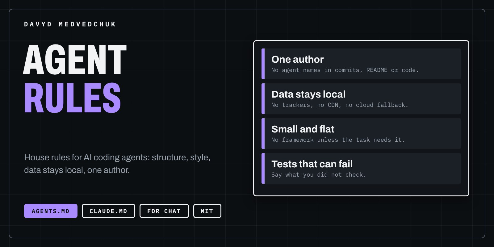

# Agent rules



My house rules for AI coding agents: small structure, plain style, data stays on the device, one author. One file you drop into a repository, and a version you can paste into a chat.

**Copy page:** open `index.html` (or the GitHub Pages link of this repo), pick a version, press Copy.

## Use it

**In a repository.** Save [`AGENTS.md`](AGENTS.md) in the root. Agents that read `AGENTS.md` pick it up on their own. For Claude Code add a `CLAUDE.md` with one line:

```
@AGENTS.md
```

**In a chat.** Paste [`chat-instructions.md`](chat-instructions.md) into the custom instructions or into the instructions of a project. It is the same rules without the Git section.

## What the rules say

- **One author.** Commits carry the owner's name only. No agent signatures anywhere.
- **Ask or decide.** Ask one short question when a wrong guess is expensive; otherwise guess, say which guess, and move on.
- **Small and flat.** No framework or build step unless the task needs it.
- **Plain text.** Short sentences, no marketing clichés.
- **Privacy.** Data stays local. No trackers, no CDN files, no quiet cloud fallback.
- **Honest tests.** Every behavior gets a test that can fail, and the README says what was not checked.
- **Safe files.** Work on copies, never delete, stay inside the project folder.

Change them to fit you. The file is short on purpose, because an agent reads all of it every time.

## Tests

```
pip install playwright && playwright install chromium
python tests/test_rules.py
```

Checks that every section is there, that `CLAUDE.md` points to `AGENTS.md`, that the chat version has no Git section, that the file stays under 700 words, and that the copy page loads both versions without calling other sites.

## Limits

- I have not measured how much these rules change an agent's results. They are my working habits, written down.
- Which agents read `AGENTS.md` changes over time. Check your tool's documentation.
- `chat-instructions.md` is cut from `AGENTS.md` by hand. If you change one, change the other.

MIT. Made by [Davyd Medvedchuk](https://github.com/davydmedvedchuk).
